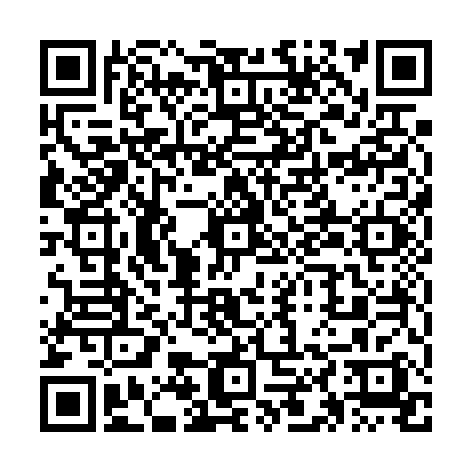

# AutoTV (v0.6.0)

Player de YouTube, TV por lista (IPTV/M3U), vídeos do celular e navegador de internet para Android,
com tela própria no Android Auto.

**Baixar o APK:** [versão mais recente](https://github.com/snakemoral/AutoTV/releases/tag/latest)
(arquivo `AutoTV-debug.apk`).

**Versões anteriores:** ficam todas na [página de versões](https://github.com/snakemoral/AutoTV/releases).
Para voltar a uma versão mais antiga, desinstale o AutoTV antes de instalar o APK antigo.

> **Status:** projeto pessoal em desenvolvimento. Testado pelo autor em um Xiaomi 12 Lite (Android 14)
> com Android Auto. As versões saem sem bateria de testes; espere falhas, principalmente no carro.

## O que tem

**No celular**
- **Início:** Em alta (com categorias e botão de atualizar), Ao vivo, Histórico, busca e link colado ou
  compartilhado do YouTube.
- **Seguindo:** vídeos dos canais em que você é inscrito, pela conta Google ou por arquivo do Google Takeout.
- **TV:** listas M3U/IPTV.
- **Baixados:** vídeos guardados no celular (Download, Filmes, Câmera etc.).
- **Web:** navegador com voltar, avançar, recarregar e favoritos.
- **Favoritos:** itens salvos e o interruptor "Interface avançada no carro".
- **Player:** qualidade automática ou manual (até 4K/60 fps, conforme o vídeo e o aparelho), idioma do
  áudio, legendas manuais e automáticas, brilho, tela cheia, indicador e retorno ao vivo.
- **Continuar de onde parou:** o app guarda a posição de cada vídeo. Ao abrir de novo um vídeo já
  começado (pelo Histórico ou por qualquer outra aba), ele volta do ponto em que parou.

**No carro (Android Auto)**
- Tela inicial com abas: Em alta, Seguindo, Ao vivo, Histórico, Celular, TV, Web, Favoritos e Buscar.
- Listas de vídeo com miniaturas grandes, filtros e botão de atualizar.
- Player desenhado pelo app: botões na tela, barra de progresso, ±10 s, brilho, qualidade, áudio e legendas.
- Navegador de internet, com digitação pelo teclado do Android Auto.
- Se o celular desconectar (cabo solto, saída do carro) com um vídeo tocando, ao reconectar o AutoTV
  abre direto no vídeo, do ponto em que parou.
- Se a tela do carro ficar preta, desligue "Interface avançada no carro" (aba Favoritos do celular)
  para usar o modo simples.

**Conta Google**
Em Seguindo > "Entrar com Google" o app mostra um código para digitar em google.com/device (o mesmo
método das TVs). A senha e a verificação em duas etapas ficam no navegador; o app guarda só uma chave do
YouTube, cifrada, que pode ser revogada em myaccount.google.com/permissions. Sem login, dá para importar
o `subscriptions.csv` (ou o .zip) do Google Takeout.

**Histórico sincronizado com o YouTube**
Com a conta conectada, o Histórico do AutoTV é o mesmo da sua conta do YouTube: aparecem os vídeos vistos
no celular e na TV, eles continuam do ponto em que pararam lá, e o que você assiste no AutoTV entra no
histórico da conta. Para desligar, use o interruptor "Sincronizar com o YouTube" em Início > Histórico.
"Limpar histórico" limpa só o histórico do app, não o da conta. Se o histórico de exibição estiver pausado
na sua conta Google, o YouTube não registra nada.

## Instalar
1. Baixe o `AutoTV-debug.apk` no link acima e instale. Versões novas instalam por cima da anterior.
2. Para aparecer no Android Auto: ative o modo desenvolvedor do Android Auto (10 toques em "Versão"),
   ligue **Fontes desconhecidas** e confira "Personalizar tela de início". Se o app não aparecer,
   instale com KingInstaller + Shizuku.

## Apoie o projeto
O AutoTV é gratuito e de código aberto. Se ele é útil para você e quiser apoiar o desenvolvimento,
pode fazer uma doação de qualquer valor por Pix (chave aleatória):

```
5644f99c-8b48-4aab-991f-963997ef2384
```

No app do seu banco: Pix > Pagar com chave > cole a chave acima. Ou leia o QR Code:



Pix copia e cola:

```
00020126580014br.gov.bcb.pix01365644f99c-8b48-4aab-991f-963997ef23845204000053039865802BR5906AUTOTV6006BRASIL62070503***63046A41
```

Obrigado!

## Uso responsável
Vídeo e navegador só com o carro parado. Com o carro em movimento use somente o áudio.
Extrair vídeos do YouTube e entrar na conta pelo método das TVs não são usos oficiais e podem violar os
termos do serviço. Licença: GPL-3.0 (NewPipeExtractor).
